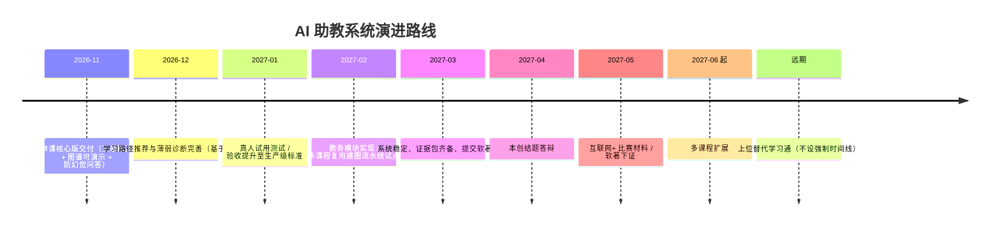

# 项目演进路线图

## 一、文档性质

本文档定义本项目从当前（2026 年 11 月）至长期愿景的演进节奏与里程碑，独立成篇，供进度管理与答辩叙事统一引用。所有时间节点以「本创 2027 年 4 月结题、此前留 1 个月备材料」为硬约束倒排。

## 二、阶段总览

## 三、里程碑定义

| 里程碑 | 时间窗 | 交付判据 | 依赖 |
| --- | --- | --- | --- |
| M1 单课核心版 | 2026-11 月底 | 学生 / 教师 / 两级管理员三端关键流程端到端跑通；Neo4j 图谱可视化可交互；RAG 问答命中知识库且具备兜底 | 队友 KG/RAG 服务已交付并可独立部署 |
| M2 路径与诊断 | 2026-12 | 学习路径推荐基于图谱产出且结果可解释；薄弱诊断由答题记录映射到图谱节点 | M1 |
| M3 生产级验收 | 2027-01 | 真人试用完成；问答命中率 ≥ 90%；关键路径经本人抽检无幻觉 | M2 |
| M4 扩展与教务 | 2027-02 | 教务模块（选课 / 成绩 / 打卡）基础可用；建图流水线参数化试点第二门课 | M3 |
| M5 稳定与软著 | 2027-03 | 系统稳定；证据包齐备；提交软著 | M4 |
| M6 结题答辩 | 2027-04 | 本创结题；现场实操 + 标准题库演示稳 | M5 |
| M7 比赛与下证 | 2027-05 | 互联网+ 材料；软著下证 | M6 |
| M8 多课程 | 2027-06 起 | 复用流水线扩展至 ≥ 2 门课 | M5 |

## 四、范围纪律

- **单课优先**：M1–M3 集中资源把「计算机网络」做深做透，不得被多课程 / 教务稀释。
- **愿景隔离**：「替代学习通」仅作对外叙事，执行上永不占用单课垂直利器的关键路径资源。
- **可砍清单**：LoRA 微调为 NICE，时间告急时首个可砍；社群 / 激励 / 移动端为 NICE，结题前不强制。

## 五、文档标准声明

本文档遵循学术性、准确性、简洁性、独立性原则，作为初稿交付，不含修订痕迹。
