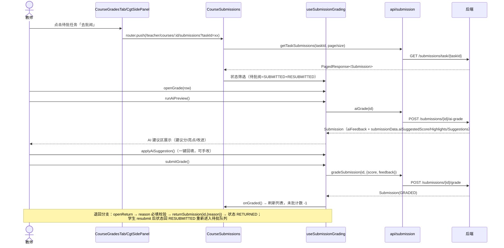
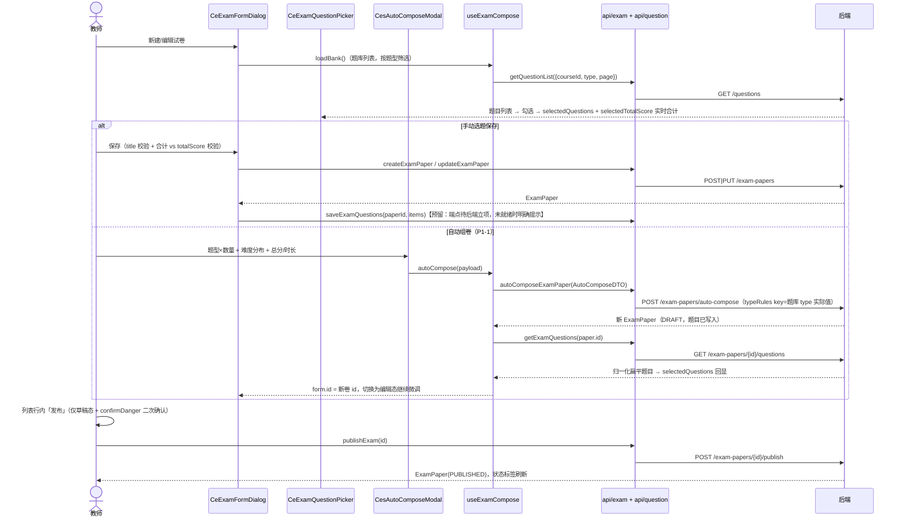

# 设计方案：试卷创建—发布—批阅核心闭环（增量）

- 项目：ai-course-platform
- 日期：2026-10-26
- 作者：架构师 高见远（Bob / software-architect）
- 输入：`docs/superpowers/prds/2026-10-26-exam-core-flow-prd.md` + 主理人拍板边界（Q1~Q5）
- 侦查方式：全量只读核对前端宿主/封装/孤儿组件与后端 Controller/DTO/ServiceImpl 源码，字段名均为现场核实，无虚构。

---

## 0. 侦查结论（对 PRD 前提的三点修正，先读这个）

### 0.1 【重大】批阅入口并非空白——CourseSubmissions 已有完整链路

PRD G1 说「前端无任何批阅入口」，**与现状不符**。教练舱已有「作业批改」页签
`src/views/teacher/cockpit/CourseSubmissions.vue`（683 行，路由 `/teacher/courses/:id/submissions`），已实现：

- 左列任务列表 + 右列提交表格（`getTaskSubmissions`，分页）；
- 批改 Modal（`gradeSubmission`，score + feedback，含提交内容与附件展示）；
- 退回 Modal（`returnSubmission`，reason 必填，与 Q2 一致）；
- 「AI 评分」按钮（`aiGrade`，调用后刷新列表，**无建议回填交互**）；
- **已支持 `?taskId=` query 直达指定任务**（`loadTasks` 读 `route.query.taskId`，含任务不存在降级提示）。

因此 P0-1 的正确形态不是新建 GradingWorkspace，而是**增强 CourseSubmissions + 打通下钻**。

### 0.2 【阻断】手动选题保存无后端端点（P0-3 缺口）

`exam_questions` 表在全后端只有一条写入路径：`POST /exam-papers/auto-compose`。
`ExamPaperController`/`TeacherController` 等全部 Controller 中**不存在**任何「向试卷写入/替换题目」的端点。
即 PRD P0-3「勾选题目保存」在「后端零改」约束下**无法闭环**。前端本批交付选题区 UI + 自动组卷全链，
保存侧预留 `saveExamQuestions` 封装（约定 `POST /exam-papers/{id}/questions`），端点就绪即接通。
**严重度：高（阻断），需主理人中转裁定后端补端点或调整范围。**

### 0.3 【中】学生端提交入口疑似整体缺失

`views/student/**` 中没有任何 `submitAssignment`（`/student/assignments/{id}/submit`）或 `submitTask` 的调用点
（仅 api/student.ts 定义 + api 测试）；`student/academic/Grades.vue` 亦无 score/feedback 展示逻辑。
S1「确认学生端有提交入口」走查结论：**入口不存在，不是「只补缺」能一句话带过的量级**。是否入本批需裁定。

### 0.4 其他现场事实（设计输入）

| # | 事实 | 影响 |
|---|------|------|
| F1 | `ExamPaper.status` 持久化为枚举 name（`DRAFT`/`PUBLISHED`/`ARCHIVED`），而 `CeExamTable.vue:25/35` 判 `row.status === '已发布'` → 已发布卷恒显示「草稿」且发布按钮恒显 | 前端 bug，T04 修复（状态映射常量） |
| F2 | `aiGradeSubmission` 把建议分写进 `submissionData` JSON（`aiSuggestedScore`/`aiHighlights`/`aiSuggestions`），评语写 `aiFeedback` 字段，**不写 score/status** | 「AI 预批→一键回填」零后端改可行：前端解析返回的 Submission 即可 |
| F3 | `AutoComposeDTO.typeRules` 的 key 与 `Question.type` 直接分组匹配（`questionsByType.getOrDefault(type)`），即题库实际值 `SINGLE/MULTIPLE/JUDGE/FILL/ESSAY/CODE`；DTO 注释里的 `SINGLE_CHOICE` 风格是误导 | auto-compose 表单直接复用现役 `TYPE_OPTS`，勿按注释造 key |
| F4 | `GET /exam-papers/{id}/questions` 返回 `{id, orderIndex, points, question:{…}}` 包装结构，前端 `normalizeExamQuestions` 已归一化为扁平对象（`score = points`）；教师视角含标准答案 | 编辑回显直接用 `getExamQuestions`，已选题目 id 取归一化后的 `question.id` |
| F5 | `GET /tasks/pending-grading` 返回 `List<Task>`（教师本人维度），`useCourseGradesTab` 已按 courseId 过滤为 `pendingTasks` | 下钻连接器数据就绪 |
| F6 | `CourseGradesTab.vue` 挂载于 `views/teacher/CourseDetail.vue`（`/teacher/courses/:id/detail`） | 下钻目标为同课程另一路由，`router.push` 即可 |
| F7 | 发布端点幂等防护：重复 publish 后端抛「试卷已发布」BusinessException | 前端按草稿态才显示发布按钮 + 二次确认，防呆即可 |
| F8 | `GradeDTO = {score: BigDecimal(0~1000, required), feedback(≤5000)}`；return 的 body 是 `Map{reason}` | 批改表单校验口径 |

---

## 1. 实现方案

### 1.1 总体组件树与数据流

```
/teacher/courses/:id/detail  （CourseDetail.vue）
└─ CourseGradesTab.vue（小改）
   └─ CgtSidePanel.vue（小改：pendingTasks 行 + 「去批阅」→ emit('grade-task', taskId)）
        └─ router.push(`/teacher/courses/${courseId}/submissions?taskId=${taskId}`)

/teacher/courses/:id/submissions  （CourseSubmissions.vue，主战场）
├─ useSubmissionGrading.ts（新建域 composable，FE-14 拆分）
│    ├─ 任务/提交数据流（自 CourseSubmissions 迁入）
│    ├─ 状态筛选：全部｜待批阅(SUBMITTED+RESUBMITTED)｜已批阅(GRADED)｜已退回(RETURNED)
│    ├─ 批改流：openGrade → [AI 预批 runAiPreview → 回填 score/feedback] → submitGrade
│    └─ 退回流：openReturn(reason 必填) → submitReturn
├─ 批改 Modal（保留自研 Modal，新增 AI 建议区 + 回填）
└─ 退回 Modal（不变）

/teacher/courses/:id/exams  （CourseExams.vue 宿主）
├─ CeExamTable.vue（状态列/按钮改用 examPaperStatus 映射）
└─ CeExamFormDialog.vue（el-dialog → 自研 Modal 迁移 + 选题区挂载）
     ├─ CeExamQuestionPicker.vue（新建：题库列表 + 题型筛选 + 勾选 + 合计）
     ├─ CesAutoComposeModal.vue（新建：自动组卷小表单，P1-1）
     └─ useExamCompose.ts（新建域 composable：题库加载/勾选/合计/回显/auto-compose）
```

### 1.2 关键决策与理由

**D1｜批阅工作流：增强 CourseSubmissions，不新建 GradingWorkspace（否决 PRD §4.2 的「新页面/新面板」形态）**

- CourseSubmissions 已实现 PRD §4.2 的左列（任务）+ 右列（提交列表）与全部三个写动作，缺的只是
  状态筛选分组与 AI 建议回填——增量约 150 行；新建 GradingWorkspace 是重建 683 行存量能力，浪费且引入双入口漂移。
- PRD §4.1 判定「挂 CourseGradesTab」的理由（pendingTasks 入口天然存在）依然成立，但结论修正为：
  CourseGradesTab 的 pendingTasks 行加「去批阅」跳转（一行 `router.push`），批阅动作留在专门页签——
  两个数据源（pending-grading、submissions/task）职责不变，用 URL query 做连接器（CourseSubmissions 已支持）。
- Q1 边界（只做 Submission 链路）天然满足。

**D2｜AI 预批（Q3 升 P0）：预批 → 建议区展示 → 一键回填 → 教师确认走 /grade**

- 依据 F2：`aiGrade(id)` 返回 Submission，前端从 `aiFeedback` 与 `submissionData`（JSON 字符串，parse）
  读 `aiSuggestedScore/aiHighlights/aiSuggestions`；建议区展示 highlights/suggestions，
  「采纳建议」按钮把建议分/评语填入表单（可改），最终提交仍走 `POST /grade`（分数停留 submission，Q4 不追加落账）。
- 现按钮「AI 评分」直接调用后刷新、无感知产出，本批改为「AI 预批」语义（不直接改任何数据）。
- 内容为空的提交后端会抛「提交内容为空，无法进行AI评分」，按钮对空内容提交禁用。

**D3｜CgtGradeDialog.vue：不复活，就地增强（判定依据 + API 核对结果）**

- 契约核对：其 `gradeForm = {score, comment, fullScore}` 与现 `GradeDTO {score, feedback}` **字段名不一致**
  （comment vs feedback），且 480px 纯表单无作答内容/附件展示——信息架构弱于 CourseSubmissions 现有 Modal。
- 复活它 = 改 props 契约 + 迁移内容展示 + 双调用方适配；就地增强 = 零迁移成本。**不复活**，
  组件按 PRD 处置继续「保留、记录」。CourseSubmissions 批改域逻辑抽 `useSubmissionGrading`（可测、可复用），
  这是比复活一个契约过时的展示组件更值钱的重用。

**D4｜CeExamFormDialog 大改即迁移：el-dialog → 自研 Modal（一次到位）**

- 本批对该弹窗是结构级扩展（+选题区 +自动组卷），符合 Phase 4「大改即迁移」口径；迁移后删除
  `ref + useDialogFocus`（Modal 内部自接焦点），不写 destroy-on-close（Modal v-if 卸载天然覆盖）。
- 宿主里两个小弹窗（查看题目/统计）本批不动，不扩大爆炸半径。
- `ExamFormDialog.vue`（289 行孤儿）维持「仅参考、不挂载」；其字段设计中本批采纳的只有
  「选题区」交互思路，具体实现按现役契约重写。

**D5｜选题保存的双轨交付**

- 保存流程：`create/updateExamPaper`（试卷字段）→ `saveExamQuestions(paperId, items)`（题目清单，预留）。
- 后端端点未就绪期间：选题区完整可用、合计校验可用、回显可用；保存时题目清单不落库并给出明确提示
  （「题目保存通道待开通，自动组卷不受影响」）。0.2 裁定后一行接通。

**D6｜自动组卷交互（P1-1）**：自动组卷是**创建新试卷**（后端直接建卷并写题目，返回 ExamPaper），
不是给当前表单回填。交互：成功后把表单切换为编辑该新卷（`form.id = paper.id`），并拉
`getExamQuestions(paper.id)` 回显其题目清单，教师可继续微调再保存字段。

---

## 2. 文件清单（相对 `frontend/`；新建★ / 修改✎）

| 文件 | 动作 | 预估行数变化 | 说明 |
|------|------|------------|------|
| `src/api/exam.ts` | ✎ | +25 | 新增 `autoComposeExamPaper(data)`；预留 `saveExamQuestions(id, items)`（注释标注端点待后端立项）；默认导出面同步 |
| `src/api/__tests__/exam.test.ts` | ✎ | +30 | 新封装 URL/payload 契约测试（对齐 `api-modules.test.ts` 风格） |
| `src/constants/examPaperStatus.ts` | ★ | ~30 | `PUBLISHED/DRAFT/ARCHIVED` → `{label, tagType, canPublish}` 映射，宿主/表格共用 |
| `src/constants/examPaperStatus.test.ts` | ★ | ~25 | 映射契约测试 |
| `src/composables/useSubmissionGrading.ts` | ★ | ~260 | 批阅域逻辑（见 §3.2 导出面） |
| `src/composables/__tests__/useSubmissionGrading.test.ts` | ★ | ~200 | 筛选/回填/校验/退回必填 |
| `src/views/teacher/cockpit/CourseSubmissions.vue` | ✎ | 683→约 550 | 接 composable；提交表加状态筛选 chips；批改 Modal 加 AI 建议区（模板增量，逻辑外移） |
| `src/components/course/CgtSidePanel.vue` | ✎ | +15 | pendingTasks 行加「去批阅」，emit('grade-task', task) |
| `src/components/CourseGradesTab.vue` | ✎ | +10 | 透传 grade-task → `router.push(...submissions?taskId=)` |
| `src/composables/useExamCompose.ts` | ★ | ~200 | 选题域逻辑（见 §3.2） |
| `src/composables/__tests__/useExamCompose.test.ts` | ★ | ~180 | 勾选/合计/回显/auto-compose payload |
| `src/views/teacher/cockpit/components/CeExamFormDialog.vue` | ✎ | 75→约 240 | 迁移自研 Modal（width 640）+ 挂选题区 + 已选合计行 + 自动组卷按钮 |
| `src/views/teacher/cockpit/components/CeExamQuestionPicker.vue` | ★ | ~170 | 题库列表（题干截断/题型 tag/分值 input/勾选）+ 题型筛选 + 分页 |
| `src/views/teacher/cockpit/components/CesAutoComposeModal.vue` | ★ | ~130 | 题型×数量 + 难度分布(%) + 总分/时长 |
| `src/views/teacher/cockpit/CourseExams.vue` | ✎ | +40/-10 | form 扩展 `questionIds/selectedQuestions`；保存流程接 useExamCompose；发布加 `confirmDanger`；状态改映射 |
| `src/views/teacher/cockpit/components/CeExamTable.vue` | ✎ | ±8 | 状态列/发布按钮改用 examPaperStatus 映射（修 F1 bug） |
| `src/views/teacher/cockpit/components/__tests__/CeExamQuestionPicker.test.ts` | ★ | ~120 | 勾选联动合计、筛选、禁用已选 |

> 行数预估含注释与测试；`useSubmissionGrading` 拆分遵循 FE-14（编排层保留在 .vue，导出面逐名不变的部分维持原签名语义）。

---

## 3. 接口与数据结构（字段名均现场核实自后端源码）

### 3.1 本批前端消费的 API 形状

```ts
// ---- 批阅链路（SubmissionController，全部已封装，零新增）----
// GET /submissions/task/{taskId}?page&size → ApiResponse<PagedResponse<Submission>>
//   PagedResponse 兼容读取走 utils/response 的 pickList/readTotal，不新增假设
interface Submission {            // entity/Submission.java
  id: number; taskId: number; studentId: number
  content: string | null
  fileUrls: string | null         // JSON 数组字符串或逗号分隔（前端已有 normalizeFileUrls 兼容）
  status: 'SUBMITTED' | 'GRADED' | 'RETURNED' | 'RESUBMITTED'
  score: number | null            // 批阅后写入
  maxScore?: number | null        // 非表字段，VO 映射展示用
  feedback: string | null         // 教师评语
  aiFeedback: string | null       // AI 评语
  submissionData: string | null   // JSON 字符串：AI 建议（见下）
  attemptNumber?: number; isLate?: boolean; submittedAt?: string; gradedAt?: string; returnedAt?: string
}
// POST /submissions/{id}/grade    body: { score: number /*0~1000 必填*/, feedback?: string /*≤5000*/ } → Submission
// POST /submissions/{id}/return   body: { reason: string /*必填，前端强制*/ } → Submission
// POST /submissions/{id}/ai-grade body: 无 → Submission（建议写入 aiFeedback + submissionData，不动 score/status）
//   submissionData JSON 契约：{ aiSuggestedScore?: string, aiHighlights?: string, aiSuggestions?: string, ... }

// ---- 试卷链路（ExamPaperController）----
interface ExamPaper {
  id?: number; courseId: number; title: string /*必填*/; description?: string
  duration?: number; totalScore?: number
  status: 'DRAFT' | 'PUBLISHED' | 'ARCHIVED'
  questionCount?: number
}
// GET  /exam-papers/course/{courseId}?page&size（教师全量；学生仅 PUBLISHED）
// POST /exam-papers            body: ExamPaper（无题目字段！）
// PUT  /exam-papers/{id}       body: ExamPaper
// POST /exam-papers/{id}/publish → ExamPaper（重复发布后端抛「试卷已发布」）
// GET  /exam-papers/{id}/questions → List<{ id, orderIndex, points, question: Question }>
//   前端 getExamQuestions 已归一化为扁平 { ...question, score: points, orderIndex }；教师视角 question 含答案
// POST /exam-papers/auto-compose body: AutoComposeDTO（本次新增封装）：
interface AutoComposeDTO {
  courseId: number; title: string; description?: string
  totalScore?: number; duration?: number
  typeRules: Record<string, number>      // key 必须是题库 Question.type 实际值：SINGLE/MULTIPLE/JUDGE/FILL/ESSAY/CODE（F3，勿按 DTO 注释的 *_CHOICE 风格）
  difficultyRatio?: Record<'EASY'|'MEDIUM'|'HARD', number>  // 百分比
  questionCount?: number; shuffleQuestions?: boolean; shuffleOptions?: boolean
}
// → ExamPaper（后端直接建卷 + 写题目，status DRAFT）

// ---- 题库（选题区数据源，教师权限）----
// GET /questions?page&size&courseId&type&difficulty → PagedResponse<Question>
//   Question: { id, courseId, type, content, options, difficulty, score, ... }（教师视角含 correctAnswers/explanation）

// ---- 待批任务（下钻数据源，已封装 taskApi.getPendingGrading）----
// GET /tasks/pending-grading → List<Task>（Task 含 id/title/courseId/…；前端按 courseId 过滤）

// ---- 预留（后端缺口，见 §8-1）----
// POST /exam-papers/{id}/questions  body: { questions: [{ questionId: number, points: number, orderIndex: number }] }（形状待后端立项确认）
```

### 3.2 新增 composable 导出面

```ts
// src/composables/useSubmissionGrading.ts
export function useSubmissionGrading(options: {
  courseId: Ref<number | null>
  onGraded?: () => void   // 批改/退回成功后的宿主回调（刷新提交列表 / 通知 tab）
}) {
  return {
    statusFilter,          // Ref<'ALL'|'PENDING'|'GRADED'|'RETURNED'>
    filteredSubmissions,   // ComputedRef<Submission[]>（PENDING = SUBMITTED + RESUBMITTED）
    pendingCount,          // ComputedRef<number>
    gradeModal,            // { visible, row, form: {score, feedback}, maxScore, aiLoading, aiResult }
    returnModal,           // { visible, row, form: {reason} }
    openGrade(row): void
    runAiPreview(): Promise<void>     // aiGrade → parse aiFeedback/submissionData → 填 aiResult；不自动改表单
    applyAiSuggestion(): void         // 「采纳建议」→ 建议分/评语回填 gradeModal.form（可再改）
    submitGrade(): Promise<boolean>   // 校验分数 0~maxScore → gradeSubmission(id, {score, feedback})
    openReturn(row): void
    submitReturn(): Promise<boolean>  // reason trim 非空 → returnSubmission(id, {reason})
    closeAll(): void
  }
}

// src/composables/useExamCompose.ts
export function useExamCompose(options: {
  courseId: Ref<number | null>
  form: { id: Ref<number | null>; totalScore: Ref<number> }  // 合计校验需要
}) {
  return {
    bankQuestions, bankLoading, bankTotal, bankPage, bankType,  // 题库列表状态
    loadBank(): Promise<void>,                                 // GET /questions?courseId&type&page
    selectedQuestions,        // Ref<Array<{ questionId, type, content, score }>>
    selectedTotalScore,       // ComputedRef<number>（合计，供与 form.totalScore 校验）
    isSelected(questionId): boolean
    toggleQuestion(q): void   // 勾选/取消；分值默认取题目 score，可改
    updatePoints(questionId, points): void
    restoreFromPaper(paperId): Promise<void>  // 编辑回显：getExamQuestions → selectedQuestions
    autoCompose(payload): Promise<ExamPaper | null>  // autoComposeExamPaper + 成功后 restoreFromPaper
    autoComposing: Ref<boolean>
    reset(): void
  }
}
```

### 3.3 常量导出（`src/constants/examPaperStatus.ts`）

```ts
export const EXAM_PAPER_STATUS = {
  DRAFT:     { label: '草稿',   tagType: 'info',    canPublish: true },
  PUBLISHED: { label: '已发布', tagType: 'success', canPublish: false },
  ARCHIVED:  { label: '已归档', tagType: 'info',    canPublish: false },
} as const
export function examPaperStatusView(status?: string | null): { label: string; tagType: string; canPublish: boolean }
```

---

## 4. 时序图

### 4.1 批阅主流程（含 AI 预批回填）



### 4.2 选题 / 自动组卷保存流程



---

## 5. 任务列表（有序；T02 与 T03/T04 两条线可并行）

| ID | 任务名 | 文件 | 依赖 | 优先级 | 验收点 |
|----|--------|------|------|--------|--------|
| T01 | API 层与状态常量基础设施 + 学生端现状走查 | `src/api/exam.ts`✎、`src/api/__tests__/exam.test.ts`✎、`src/constants/examPaperStatus.ts`★、`src/constants/examPaperStatus.test.ts`★ | — | P0 | ① `autoComposeExamPaper`/预留 `saveExamQuestions` 封装 + 契约测试过；② examPaperStatus 映射 + 测试过；③ 学生端走查结论（S1 提交入口、S2 成绩可见性）写入 PR 描述回报主理人，**不擅自改学生端代码** |
| T02 | 批阅工作流增强（P0-1 + AI 预批回填） | `src/composables/useSubmissionGrading.ts`★、`src/composables/__tests__/useSubmissionGrading.test.ts`★、`src/views/teacher/cockpit/CourseSubmissions.vue`✎、`src/components/course/CgtSidePanel.vue`✎、`src/components/CourseGradesTab.vue`✎ | T01 | P0 | ① GradesTab 待批任务「去批阅」→ 落在 submissions 页签并自动选中该任务；② 提交表状态筛选 chips 生效，待批=SUBMITTED+RESUBMITTED；③ AI 预批→建议区→采纳回填→提交批阅全链可用，空内容提交按钮禁用；④ 退回 reason 必填；⑤ 批改后未批计数随刷新变化；⑥ useSubmissionGrading 测试全绿 |
| T03 | 试卷表单选题区 + 自动组卷（P0-3 + P1-1） | `src/composables/useExamCompose.ts`★、`src/composables/__tests__/useExamCompose.test.ts`★、`CeExamFormDialog.vue`✎（迁移自研 Modal）、`CeExamQuestionPicker.vue`★、`CesAutoComposeModal.vue`★ | T01 | P0（选题）/P1（自动组卷） | ① 弹层为自研 Modal（width 640），无 ref+useDialogFocus、无 destroy-on-close；② 题库列表题型筛选+分页可用，勾选实时合计并与总分字段校验；③ 编辑态 `restoreFromPaper` 回显已选题目；④ 自动组卷成功后表单切编辑态且题目回显；⑤ typeRules key 用题库实际 type 值（F3）；⑥ 单测全绿 |
| T04 | 宿主集成与状态契约修复 | `CourseExams.vue`✎、`CeExamTable.vue`✎、`src/views/teacher/cockpit/components/__tests__/CeExamQuestionPicker.test.ts`★ | T03 | P0 | ① 已发布卷显示「已发布」且无发布按钮（修 F1）；② 发布前 confirmDanger 二次确认；③ 保存流程接选题清单（端点未就绪时明确提示、不静默丢弃）；④ 全链手测：新建→选题→保存→发布 在 CourseExams 闭环 |
| T05 | 门禁收口与回归 | 全批改动文件的类型定型（PropType/TS）；如有遗漏按门禁修复 | T02、T04 | P0 | ① vitest 全绿（183+ 新增用例）；② lint 0/0；③ typecheck 棘轮 13 持平（新代码零 error）；④ build + size:gate 过；⑤ PR 描述含学生端走查结论与 §8 待明确事项 |

并行性：T02（批阅线）与 T03→T04（试卷线）仅共同依赖 T01，可两人并行；T05 收口。

---

## 6. 依赖包

**零新增**。全部能力由现有依赖覆盖：Vue 3、Element Plus `2.14.7`（精确版本，不动）、Pinia、vue-router、vitest + VTU、echarts（已有，本批不新增图表）。AI 预批无新库（后端能力 + JSON 解析）。

---

## 7. 共享知识（跨文件约定）

1. **响应信封**：`{code, message, data}`；列表读取一律走 `utils/response` 的 `unwrap/pickList/readTotal/fetchAllPages`，禁止手搓 `res.data.records`。
2. **API 封装样式**：统一在 `src/api/*.ts`，命名动词开头（`getXxx/postXxx` 或领域动词），默认导出对象同步登记；新封装必须带 `src/api/__tests__` 契约测试（URL + payload）。
3. **类型放置**：领域接口放使用方就近或 `src/api/*.ts` 内联（沿用 task.ts 的 `export interface` 风格）；跨宿主共享的枚举映射放 `src/constants/`。
4. **状态契约**（本批钉死，禁止魔法字符串）：
   - `ExamPaper.status`：`DRAFT | PUBLISHED | ARCHIVED`（后端枚举 name），展示/按钮判定只走 `examPaperStatusView()`；
   - `Submission.status`：`SUBMITTED | GRADED | RETURNED | RESUBMITTED`，待批集合 = `SUBMITTED + RESUBMITTED`。
5. **AI 建议契约**：`aiFeedback`（评语文本）+ `submissionData` JSON 字符串内 `aiSuggestedScore/aiHighlights/aiSuggestions`；前端 parse 失败一律静默降级为「无建议」，不阻塞批改表单。
6. **弹层纪律**：新弹层一律自研 `Modal`（`width`/`title` props、`closed` 语义）；Modal 内部自接焦点，调用方**禁止** `ref + useDialogFocus`；不写 `destroy-on-close`。
7. **大文件纪律**：组合式拆分 <500 行（FE-14：编排层留 .vue，域逻辑进 composable，导出面逐名稳定）。
8. **composable 命名**：`use<Domain><Action>`，文件置于 `src/composables/`，测试同目录 `__tests__/`；ref/ returned 状态用 TS 泛型定型。
9. **Element Plus 固定 `2.14.7`**；图标用 `@element-plus/icons-vue`；token 颜色走 `--ac-*`/`--surface` 等 CSS 变量，不写死色值。

---

## 8. 待明确事项（提请主理人中转裁定，本设计未擅自变更范围）

| # | 事项 | 严重度 | 说明与建议 |
|---|------|--------|-----------|
| 1 | **手动选题保存端点缺失** | **高（阻断 P0-3 保存半环）** | `exam_questions` 无任何写端点（唯一写入路径是 auto-compose）。建议后端补 `POST /exam-papers/{id}/questions`（批量替换语义，body 形状建议 `{questions:[{questionId, points, orderIndex}]}`，需与 `ExamQuestion` 实体对齐）；前端已按此预留 `saveExamQuestions`。裁定前 T03/T04 按 D5 双轨交付 |
| 2 | **P0-1 实现形态与 PRD §4.2 偏离** | 中 | CourseSubmissions 已有批阅链路（§0.1），本设计「增强 + 下钻」替代「新建 GradingWorkspace」。请 PM 确认口径变更；若 PM 坚持 PRD 形态，需要求项目主批准重建（约 +400 行重复） |
| 3 | **学生端缺口（S1/S2）** | 中 | 走查证据：`views/student/**` 无任何提交调用点（S1 入口整体缺失，非小补）；`student/academic/Grades.vue` 无 score/feedback 展示逻辑（S2 待确认数据源后定改法）。是否入本批、由谁做，需裁定（T01 只产出结论） |
| 4 | AI 预批语义统一 | 低 | 后端 ai-grade 不落 score（F2），现「AI 评分」按钮易被误解为直接改分；本批统一为「预批→回填→教师确认」。知会 PM 更新文案即可 |
| 5 | AutoComposeDTO 注释与实现不符 | 低 | DTO 注释的题型 key（`SINGLE_CHOICE` 等）与实际消费（题库 type 原值）不一致（F3）。前端按实现消费；建议后端顺手修注释，非阻断 |
| 6 | 考试卷面批阅 | 低 | 按 Q1 不做，`exam-sessions` 的 `manualGrade/autoGrade` 链路另行立项，本设计不涉及 |
